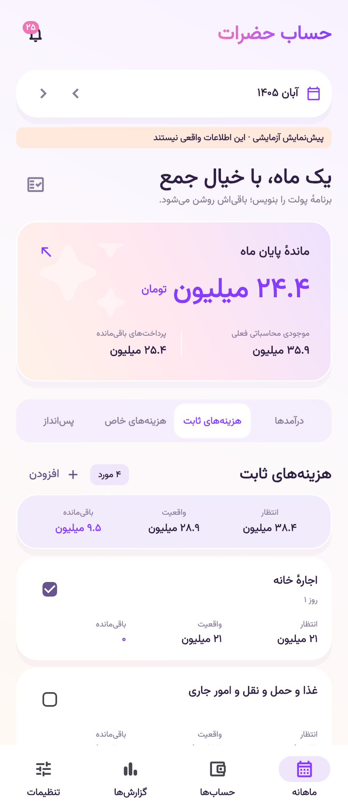

# حساب حضرات 💜

اپ شخصی فارسی برای اندروید؛ حساب‌وکتاب ماهانه، ورود موجودی بانک‌ها، پس‌انداز، خرید چهارقسطی و گزارش‌های آفلاین. رابط راست‌به‌چپ، فونت همراه Vazirmatn و رنگ‌های پاستلی از تصاویر مرجع پیروی می‌کنند.



## اجرا

نسخهٔ توسعه: **Flutter 3.47.7 / Dart 3.13.5**، جاوا ۱۷ و Android SDK. حداقل اندروید API 23؛ Google Play Services برای اتصال گوگل لازم است، برای استفادهٔ آفلاین لازم نیست.

```sh
flutter pub get
flutter run
```

پیش‌نمایش مرورگر:

```sh
flutter run -d chrome
```

برای نمایش دادهٔ ساختگی، `?demo=true` را به نشانی مرورگر اضافه کنید یا `flutter run -d chrome --dart-define=DEMO=true` اجرا کنید. این حالت ذخیره‌سازی دائمی و ارسال به گوگل ندارد. اپ عادی با اطلاعات خالی شروع می‌شود؛ هیچ دادهٔ نمونه‌ای به اطلاعات شخصی اضافه نمی‌شود. اتصال گوگل مخصوص نسخهٔ اندروید است.

## دریافت APK از گیت‌هاب

در صفحهٔ **Actions → Android APK → Run workflow** گردش‌کار را اجرا کنید. تغییرات `main` و `master` نیز بیلد را اجرا می‌کنند. پس از موفقیت، از بخش **Artifacts** خروجی `hesab-hazrat-android-…` را دریافت و از ZIP، فایل `app-release.apk` را نصب کنید. خروجی شامل `signing-fingerprints.txt` با SHA-1/SHA-256 همان APK است.

بدون هیچ secret هم APK قابل نصب با امضای debug تولید می‌شود. این امضا در runnerهای موقت ممکن است تغییر کند؛ برای نصب به‌عنوان به‌روزرسانی و ورود گوگل پایدار، یک کلید شخصی ثابت تنظیم کنید. نسخهٔ بدون تنظیم OAuth همچنان کاملاً آفلاین قابل استفاده است.

## تنظیم گوگل؛ بدون سرور و بدون کلید سرویس‌اکانت

۱. در Google Cloud یک پروژه بسازید و **Google Sheets API** را فعال کنید.
۲. صفحهٔ OAuth consent را تنظیم کنید؛ برای استفادهٔ شخصی، ایمیل خودتان را در Test users اضافه کنید. تنها دسترسی دادهٔ درخواستی `https://www.googleapis.com/auth/spreadsheets` است؛ این scope امکان دسترسی به شیت‌های حساب را دارد، اما برنامه فقط شناسهٔ تنظیم‌شده را استفاده می‌کند.
۳. یک OAuth client از نوع **Android** بسازید:

- Package name: `ir.hazrat.hesab_hazrat`
- SHA-1: اثر انگشت **همان گواهی امضای APK نصب‌شده**، از خروجی Actions.

۴. برای بیلد محلی debug نیز یک Android OAuth client با SHA-1 محلی ثبت کنید:

```sh
keytool -list -v -alias androiddebugkey -keystore ~/.android/debug.keystore -storepass android -keypass android
```

۵. در اپ، شناسه یا لینک شیت شخصی را در **تنظیمات → شیت متصل** وارد و ذخیره کنید، سپس **ورود با گوگل و همگام‌سازی** را بزنید و حسابی را انتخاب کنید که شیت را دارد. نیازی به Firebase، Web client secret، `google-services.json` یا سرور نیست. اگر گوگل برای اپ آزمایشی هشدار نمایش داد، فقط برای پروژهٔ شخصی خودتان ادامه دهید. انتشار عمومی ممکن است به تأیید OAuth نیاز داشته باشد.

اتصال از Google Identity Services **AuthorizationClient** بومی اندروید استفاده می‌کند. توکن فقط در حافظهٔ موقت و کش مدیریت‌شدهٔ Play Services است؛ در JSON اطلاعات مالی، لاگ یا مخزن ذخیره نمی‌شود. قطع اتصال دسترسی به اطلاعات آفلاین را نمی‌بندد.

راهنمای رسمی: [مجوزدهی گوگل در اندروید](https://developer.android.com/identity/authorization)، [Google Sheets API](https://developers.google.com/workspace/sheets/api/reference/rest/v4/spreadsheets/batchUpdate).

## امضای ثابت و انتشار شخصی

یک‌بار، بیرون از مخزن، کلید بسازید و پشتیبان امن نگه دارید:

```sh
keytool -genkeypair -v -keystore hesab-hazrat.jks -alias hesab-hazrat -keyalg RSA -keysize 2048 -validity 10000
base64 < hesab-hazrat.jks | tr -d '\n'
```

در **Repository Settings → Secrets and variables → Actions** این چهار secret را اضافه کنید:

| نام | مقدار |
|---|---|
| `ANDROID_KEYSTORE_BASE64` | خروجی base64 فایل کلید |
| `ANDROID_STORE_PASSWORD` | گذرواژهٔ فایل کلید |
| `ANDROID_KEY_PASSWORD` | گذرواژهٔ alias |
| `ANDROID_KEY_ALIAS` | `hesab-hazrat` یا alias انتخابی |

گردش‌کار خودکار کلید را مصرف می‌کند. کلید، گذرواژه و فایل `android/key.properties` در Git قرار نمی‌گیرند. SHA-1 کلید ثابت را در OAuth ثبت کنید. تعویض گواهی باعث می‌شود اندروید نصب روی نسخهٔ قبلی را نپذیرد؛ قبل از حذف اپ، خروجی JSON بگیرید یا سینک موفق انجام دهید.

برای بیلد محلی امضاشده، `android/key.properties` با `storeFile` (نسبت به `android/app`)، `storePassword`، `keyPassword` و `keyAlias` بسازید و `flutter build apk --release` اجرا کنید.

## رفتار داده و سینک

- رابط همیشه از سند محلی می‌خواند. تغییرات و نسخهٔ آخرین سینک در یک JSON پایدار نگه داشته می‌شوند. روی اندروید نوشتن با فایل موقت، flush، rename و پشتیبان انجام می‌شود؛ تراکنش‌ها سریالی‌اند. در پیش‌نمایش وب از localStorage همان مرورگر استفاده می‌شود.
- تفاوت سند فعلی با نسخهٔ مبنا، صف پایدار تغییرات است. حذف نیز به‌صورت نبودن شناسه در سند جدید، در مقایسه با مبنا حفظ می‌شود. شکست شبکه تأیید ارسال تولید نمی‌کند.
- سه نسخهٔ گوشی، مبنای آخرین سینک و شیت، فیلدبه‌فیلد مقایسه می‌شوند. تعارض حذف/ویرایش یا تغییر متفاوت یک فیلد، هر دو مقدار را حفظ می‌کند و در تنظیمات قابل انتخاب است. زمان جدیدتر خودکار برنده نمی‌شود.
- شناسه‌ها با named range مستقل برای **سلول عنوان** نگه داشته می‌شوند؛ سه بلوک کنار هم در یک سطر، مستقل‌اند. پیش از ذخیرهٔ اولین import، لنگرها به شیت متصل و دوباره خوانده می‌شوند؛ جابه‌جایی سطر، شناسه را تغییر نمی‌دهد. named rangeهای `hh_…` را دستی حذف نکنید.
- برنامه یک تب پنهان `_hesab_hazrat_v1` برای شناسه‌ها، تکرار، ارتباط اقساط و فرادادهٔ ضروری ایجاد می‌کند. این اطلاعات با تعویض گوشی از همان فایل بازیابی می‌شوند.
- مجموع اقساط دوم تا چهارم هر ارائه‌دهنده/ماه در تب محاسباتی `_اقساط_حضرات` نوشته می‌شود. جزئیات هر خرید در سطرهای مرتبط هزینهٔ ثابت ماه و متادیتا حفظ می‌شوند؛ قسط اول فقط زیر کالا است. ردیف‌های تجمیعی تاریخی به کالاهای حدسی نسبت داده نمی‌شوند. تب جمع اقساط خروجی محاسبه‌شده است؛ تغییر مالی را در سطر ماه یا اپ انجام دهید.
- قالب ماه جدید ساختاری و خالی است؛ دادهٔ واقعی ماه الگو کپی نمی‌شود. تکرارها، اقساط موجود و ماندهٔ موقت وارد می‌شوند؛ تلاش مجدد ماه یا قسط تکراری نمی‌سازد. اصلاح ماه قبل، ماندهٔ موقت دست‌نخورده را به‌روز می‌کند؛ ویرایش دستی مانده اولویت دارد.
- بلوک‌ها از عنوان و سربرگ‌ها شناسایی می‌شوند، نه با مختصات ثابت. اگر بخش یا فضای خالی امن پیدا نشود، نوشتن متوقف می‌شود و تغییرات محلی باقی می‌مانند. می‌توانید داخل همان بلوک شیت سطر خالی اضافه کنید.
- فرمول موجود به عدد ثابت تبدیل نمی‌شود. مبلغ فرمول‌دار در فرم فقط‌خواندنی است؛ آن را در شیت ویرایش کنید. خوردوخوراک فرمول‌دار از ورودی‌هایش محاسبه می‌شود، نه با بازنویسی فرمول.
- واحد پیش‌فرض شیت **هزار تومان** و ورودی اپ **تومان** است. واحد فقط پیش از نخستین دریافت قابل تغییر است. اعداد JSON با بخش اعشار حفظ می‌شوند؛ ورودی/نمایش تا سه رقم اعشار تومان (شش رقم اعشار واحد هزار تومان) دارد.
- نارنجی عنوان، وضعیت شکست است و با تیک پایان تفاوت دارد. لغو و انتقال، نارنجی شکست نمی‌گیرند. باقی‌مانده آزاد می‌شود و خودکار پس‌انداز ساخته نمی‌شود.

همگام‌سازی با دکمهٔ تنظیمات انجام می‌شود؛ سرویس دائمی پس‌زمینه ندارد. هنگام ارسال، هم‌زمان شیت را در مرورگر ویرایش نکنید: Sheets API قفل مقایسه‌وتعویض سلولی ندارد. تغییراتی که **پیش از خواندن سینک** در دو سمت انجام شده باشند توسط ادغام سه‌طرفه بررسی می‌شوند؛ ویرایش هم‌زمان در فاصلهٔ خواندن و نوشتن تضمین تراکنش چندکاربره ندارد.

## گزارش‌ها

خلاصهٔ مالی، تمام ده شاخص سند را نشان می‌دهد. پیش‌بینی از موجودی محاسباتی و تعهدهای باز و درآمد دریافت‌نشده شروع می‌شود؛ روز ۳۱ به آخرین روز معتبر منتقل می‌شود. موارد بازِ سررسیدگذشته در شروع پیش‌بینی لحاظ می‌شوند. موارد بدون روز، در خلاصه هستند و با هشدار از زمان‌بندی نمودار جدا می‌شوند. نمودار پس‌انداز فقط انتظار/واقعیت همان بخش را نشان می‌دهد. برنامهٔ اقساط سه ماه آینده حتی بدون تب ساخته‌شده قابل مشاهده است.

نمودار خطی این نسخه **پیش‌بینی از موجودی فعلی به جلو** است؛ چون شیت تاریخ دقیق ثبت هر پرداخت را ندارد، خط تاریخچهٔ روزانهٔ ساختگی تولید نمی‌کند. نقطهٔ مبنا و خط پیش‌بینی مشخص‌اند.

## آزمون و وضعیت تأیید

```sh
flutter analyze
flutter test
flutter build web
flutter build apk --release
```

تست‌ها محاسبات، تقویم و سال کبیسه، صفر/خالی، تکرار، اقساط، پایداری سند/صف، بازگردانی شکست ذخیره، ادغام فیلدی، تشخیص ساختار قدیمی، فرمول، فضای اشغال‌شده، ماندهٔ موقت و رابط باریک اندروید را پوشش می‌دهند. تولید تصویر آزمایشی: `flutter test --dart-define=SCREENSHOT=true`.

در توسعه، شیت اصلی فقط برای شناخت ساختار خوانده شده است. ارسال واقعی به شیت شخصی و ورود OAuth روی گوشی باید پس از تنظیم پروژهٔ Cloud، ابتدا روی کپی شیت آزمایش شود. برای آزمایش روی کپی، لینک همان کپی را در تنظیمات نصب آزمایشی وارد کنید. شناسهٔ شیت شخصی در سورس عمومی، APK یا Git ذخیره نشده و فقط در سند محلی گوشی نگه داشته می‌شود. تغییر شیت پس از دریافت داده غیرفعال است تا دو مجموعهٔ مالی مخلوط نشوند.

ساختار پروژه: `lib/domain` قواعد مستقل، `lib/data` ذخیره/سینک، `lib/ui` صفحه‌ها. سند کامل نیازمندی‌ها در `docs/reference/product-spec.fa.md` و تصاویر مرجع کنار پروژه‌اند.
